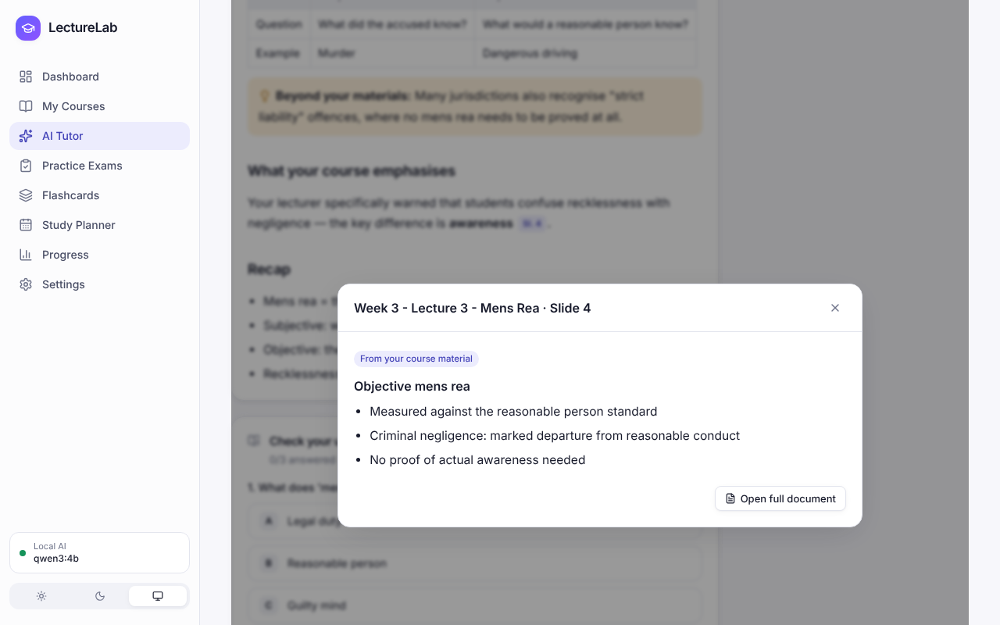
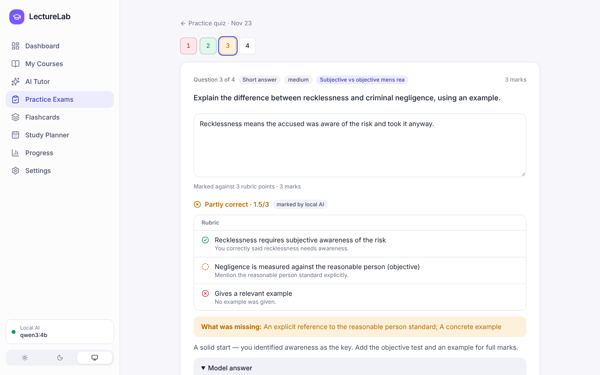
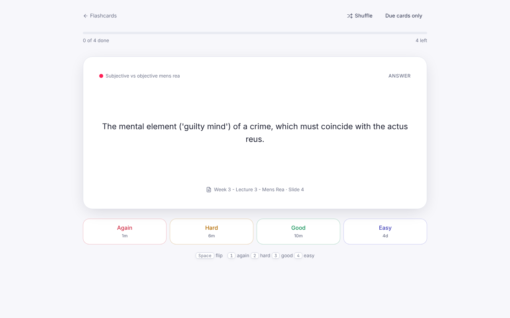
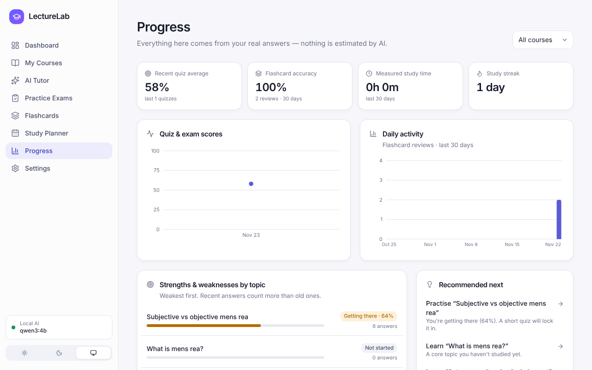

<div align="center">

# 🎓 LectureLab

**Turn your lecture slides into a private AI tutor, practice exams and flashcards.**

Runs on your own laptop with free, open-weight AI models. No subscriptions, and your course files never leave your computer.


</div>

---

## What it does

Upload your course files (PDF, PowerPoint, Word, notes). LectureLab reads them and gives you:

| | |
|---|---|
| 🧑‍🏫 **AI Tutor**: lessons built from *your* slides. Every claim links back to the exact slide or page. Ask follow-ups, or hit *Explain simpler*, *Give me an example* or *Quiz me*. |  |
| 📝 **Practice exams**: multiple choice, true/false, short answer, essays and more. Written answers are graded against a clear rubric that shows what you missed. |  |
| 🃏 **Flashcards**: generated from your material, with spaced repetition so cards come back just before you'd forget them. |  |
| 📅 **Study planner**: finds exam dates in your syllabus, then builds a day-by-day plan focused on your weakest topics. |  |
| 📈 **Progress**: strengths and weaknesses per topic, based only on your real answers. |  |

## Install (Mac)

1. Open **Terminal**: press `⌘ Command` + `Space`, type `Terminal`, press `Return`.
2. Paste this line and press `Return`:

   ```bash
   bash -c "$(curl -fsSL https://raw.githubusercontent.com/minitorch0707-png/study/main/install.sh)"
   ```

3. Wait 5–20 minutes. Most of that time is downloading the ~3 GB AI model. LectureLab opens in your browser when it's ready.

From then on, **double-click `LectureLab` on your Desktop** to start it. To update, run the same line again (your courses are kept).

<details>
<summary>Requirements and manual setup</summary>

- A Mac with Apple Silicon (M1 or newer) and 8 GB+ of memory. 16 GB is recommended.
- About 5 GB of free disk space.
- Manual setup for developers: install [Node.js 22+](https://nodejs.org) and [Ollama](https://ollama.com), then run:

  ```bash
  ollama pull qwen3:4b && ollama pull nomic-embed-text
  ```

  ```bash
  npm install && npm run build && npm start
  ```

  Then open http://127.0.0.1:3000.
</details>

## Project status

LectureLab is an **early version (alpha)**. It's useful today, and rough in places.

| Works well | Known limitations |
|---|---|
| PDF, PowerPoint (.pptx), Word (.docx), text and markdown files | Old `.ppt`/`.doc` and Keynote files must be re-saved as `.pptx`/`.docx` first |
| Lessons, quizzes, flashcards, planner and progress | Scanned PDFs (photos of pages) can't be read yet |
| Works offline. Keyword search and syllabus dates work even without AI | Answer quality depends on the small local model, so check the citations |
| | Mac only for the one-step installer. Windows and Linux need the manual setup |

Found a bug? [Open an issue](../../issues/new/choose) and include the error message.

## How it works (in one picture)

```
 Your files ──► Reader ──► slides/pages ──► Search index ──┐
 (PDF, PPTX, DOCX)        (keeps order,                     │  the most relevant slides
                           tables, notes)                   ▼
                                               Local AI model (Ollama + Qwen3)
                                                            │
                         lessons · quizzes · flashcards ◄───┘  every answer cites [slide #]
```

The AI never "learns" your files and is never retrained. Each time, LectureLab finds the most relevant slides and gives them to the model to read (a method called *retrieval-augmented generation*). That's why answers can cite the exact slide they came from.

## Project map

| Folder | What's inside |
|---|---|
| [`src/app`](src/app) | The pages you see (dashboard, tutor, exams…) and the server API (`src/app/api`) |
| [`src/components`](src/components) | Reusable UI pieces: buttons, cards, the uploader, the sidebar |
| [`src/lib/ingest`](src/lib/ingest) | Reads PDF, PowerPoint and Word files and splits them into slides/pages |
| [`src/lib/rag`](src/lib/rag) | Search over your materials (keyword + meaning) |
| [`src/lib/ai`](src/lib/ai) | Talks to the AI model. **All prompts are in [`prompts.ts`](src/lib/ai/prompts.ts)** |
| [`src/lib/learning`](src/lib/learning) | Flashcard scheduling, mastery scores, grading and the study planner (plain logic, no AI) |
| [`src/lib/services`](src/lib/services) | The features themselves, connecting everything above |
| [`tests`](tests) | Automated tests (`npm test`) |
| [`docs`](docs) | [Architecture](docs/ARCHITECTURE.md) · [Roadmap](docs/ROADMAP.md) · [Business plan](docs/BUSINESS.md) |

## Contributing

Contributions are welcome! Start with **[CONTRIBUTING.md](CONTRIBUTING.md)**. It explains how to run the project, where to make changes, and how to check your work.

## Privacy

Everything (files, quizzes, progress) is stored in `~/LectureLab/data` on your computer. The AI runs locally. The only things sent over the internet are topic names, when you ask for YouTube or Wikipedia suggestions.
