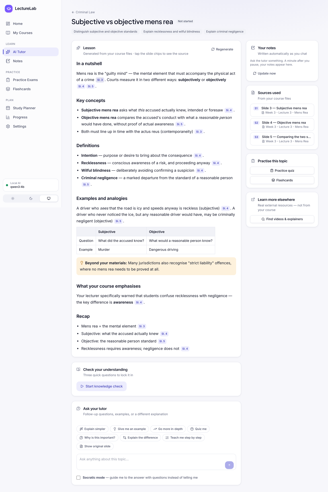
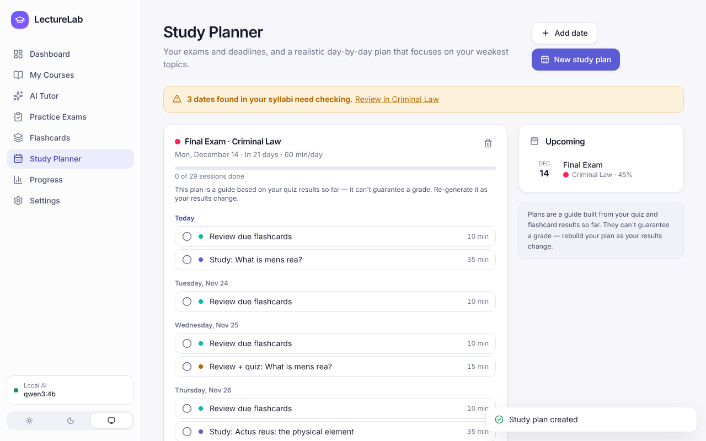

<div align="center">

# 🎓 LectureLab

**Turn your lecture slides into a private AI tutor, practice exams and flashcards.**

A free desktop app for Mac and Windows. The AI runs on *your* computer: no subscription, no account, and your course files never leave your laptop.

### [⬇ Download for Mac](https://github.com/minitorch0707-png/study/releases/latest/download/LectureLab-Mac.dmg) &nbsp;·&nbsp; [⬇ Download for Windows](https://github.com/minitorch0707-png/study/releases/latest/download/LectureLab-Windows-Setup.exe)

<sub>Mac: Apple Silicon (M1 or newer) · Windows 10/11 (64-bit) · 8 GB memory minimum, 16 GB recommended · ~6 GB free space</sub>



</div>

## Get started in 3 steps

1. **Download** the app for your computer using the links above.
2. **Install it.**
   - **Mac:** open the downloaded file and drag LectureLab into Applications. The first time you open it, macOS may say it can't verify the app. Go to **System Settings → Privacy & Security**, scroll down and click **Open Anyway**. You only do this once.
   - **Windows:** run the installer. If you see "Windows protected your PC", click **More info → Run anyway**. You only do this once.
3. **Click "Set everything up".** LectureLab downloads its free AI (about 4 GB, one time) and picks the right size for your computer. Then create a course and drop in your slides.

That's it. No Terminal, no accounts. Updates arrive inside the app.

## What it does

| | |
|---|---|
| 🧑‍🏫 **AI Tutor**: lessons built from *your* slides. Every claim links back to the exact slide or page. Ask follow-ups, or hit *Explain simpler*, *Give me an example* or *Quiz me*. |  |
| 📝 **Practice exams**: multiple choice, true/false, short answer, essays and more, with clear rubric feedback that shows what you missed. |  |
| 🃏 **Flashcards**: made from your material, with spaced repetition so cards come back just before you'd forget them. |  |
| 📅 **Study planner**: finds exam dates in your syllabus and builds a day-by-day plan around your weakest topics. |  |
| 📈 **Progress**: strengths and weaknesses per topic, based on your real answers. |  |

Works with **PDF, PowerPoint (.pptx), Word (.docx)** and notes. Got an old `.ppt`, a Keynote file or Google Slides? The app tells you exactly how to convert it.

## Free and Pro

| Free | Pro: $5 |
|---|---|
| 2 courses with the AI tutor, quizzes, flashcards and progress | **Unlimited courses** |
| Mark your own written answers with the rubric | **AI marks your written answers** |
| | **Timed exam simulations** |
| | **Study planner and Exam Cram** |

Both run 100% on your computer. Unlock Pro from inside the app (**Settings → LectureLab Pro**).

## Privacy

Your files, quizzes and progress are stored only on your computer, and the AI runs there too. The only internet use: the one-time AI download, update checks, checking a Pro key, and (if you ask) finding YouTube or Wikipedia links for a topic.

## Status

LectureLab is **early (alpha)**: useful today and improving quickly. Scanned PDFs (photos of pages) can't be read yet. Answers come from a small local AI, so check the slide citations.

Found a problem? In the app, open **Settings → Help & diagnostics → Copy diagnostics**, then [open an issue](https://github.com/minitorch0707-png/study/issues/new/choose) and paste it in.

---

## For developers

<details>
<summary><b>Run from source</b></summary>

Requires [Node.js 22](https://nodejs.org). The app installs its own AI engine on first run, or uses [Ollama](https://ollama.com) if you already have it.

```bash
npm install
```

```bash
npm run dev
```

Open http://127.0.0.1:3000. To run the desktop app from source: `npm install --prefix desktop`, then `npm run desktop:start`.

```bash
npm run typecheck && npm run lint && npm test
```

</details>

| Folder | What's inside |
|---|---|
| [`src/app`](src/app) | Pages (dashboard, tutor, exams…) and the local API (`src/app/api`) |
| [`src/components`](src/components) | UI building blocks |
| [`src/lib/ingest`](src/lib/ingest) | Reads PDF, PowerPoint and Word files |
| [`src/lib/rag`](src/lib/rag) | Search over your materials |
| [`src/lib/ai`](src/lib/ai) | Talks to the AI. **All prompts are in [`prompts.ts`](src/lib/ai/prompts.ts)** |
| [`src/lib/engine.ts`](src/lib/engine.ts) | Downloads and runs the private AI engine |
| [`src/lib/learning`](src/lib/learning) | Flashcard scheduling, mastery scores, grading, planner |
| [`src/lib/product.ts`](src/lib/product.ts) | **Price, store and Free vs Pro settings** |
| [`desktop`](desktop) | The Mac/Windows app shell (Electron) |
| [`docs`](docs) | [Architecture](docs/ARCHITECTURE.md) · [Roadmap](docs/ROADMAP.md) · [Selling Pro](docs/SELLING.md) · [Releasing](docs/RELEASING.md) · [Business plan](docs/BUSINESS.md) |

Contributions are welcome. Start with [CONTRIBUTING.md](CONTRIBUTING.md).
