# LectureLab: design brief

This page explains LectureLab's look and feel to a designer or design AI (ChatGPT, Midjourney, Figma AI…). Share this link, or upload the screenshots below with the prompt at the bottom.

## The product in one sentence

A free desktop app (Mac and Windows) that turns a university student's lecture slides into a private AI tutor, practice exams, flashcards and study notes. The AI runs on the student's own laptop.

## Who it's for

- First- to fourth-year university and college students, ages 18–24, on laptops.
- They're studying under pressure: before midterms and finals, late at night.
- Many are not technical. Everything must feel obvious without instructions.
- They discover it on **TikTok**, so it has to look great in a 9:16 screen recording.

## Brand personality

**Calm, smart, encouraging.** A friendly tutor, not a corporate tool. Think Notion's clarity + Duolingo's warmth (without the cartoon mascot) + Linear's polish.

- Trustworthy and private: "your files never leave your laptop"
- Focused: no clutter, one obvious next step on every screen
- Encouraging: celebrates progress, never shames mistakes

## Current design (what exists today)

| | |
|---|---|
| Primary colour | Indigo `#5B5BD6` (dark mode `#7C7CF0`) |
| Accent gradient | `#6366F1` → `#8B5CF6` (indigo → violet), used on the logo, course headers and quick actions |
| Backgrounds | Light `#F7F7FB` page / `#FFFFFF` cards · Dark `#0D0F17` page / `#141722` cards |
| Text | `#171A2B` (dark mode `#ECEDF5`), muted `#6E7389` |
| Status | Success `#15935A`, warning `#B36B00`, danger `#D1344B` |
| Course colours | indigo, violet, rose, amber, emerald, sky, teal, slate (students pick one per course) |
| Fonts | Headings: **Plus Jakarta Sans** 600–800 · Body: **Inter** · Code: JetBrains Mono |
| Shapes | Rounded corners (12–16 px on cards, 10–12 px on buttons), soft shadows, 1 px borders |
| Icons | [Lucide](https://lucide.dev) line icons, 18 px |
| Logo (placeholder) | White graduation cap on an indigo→violet rounded square |

All colours are defined in [`src/app/globals.css`](../src/app/globals.css), so a new palette is easy to apply.

## Screens

| Screen | What it does |
|---|---|
| 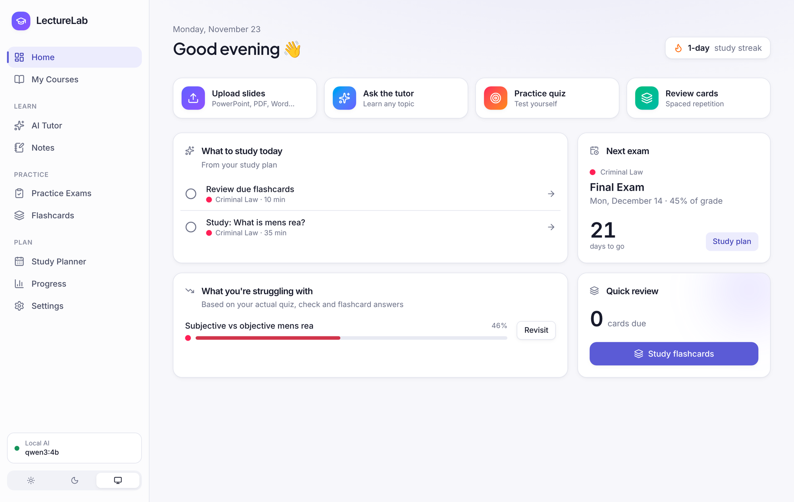 | **Home:** quick actions, a getting-started checklist, what to study today, the next exam, weak topics |
| 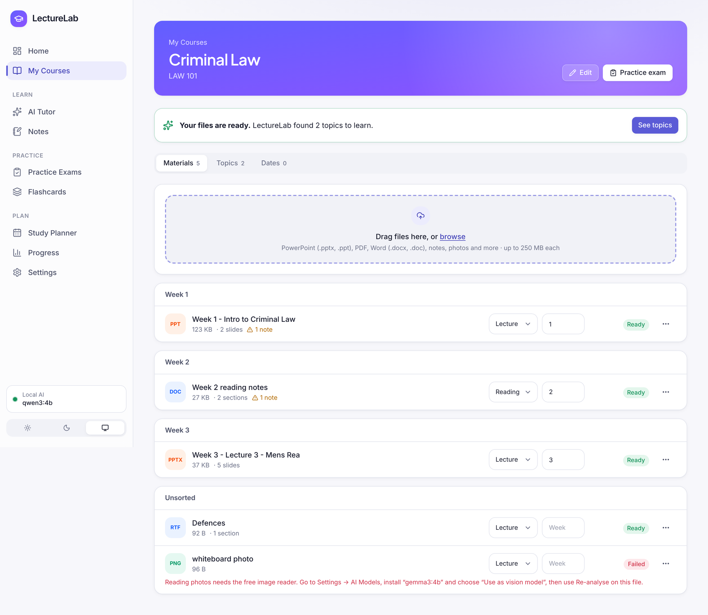 | **Course:** drag-and-drop files (PowerPoint, PDF, Word, photos…), organised by week |
| 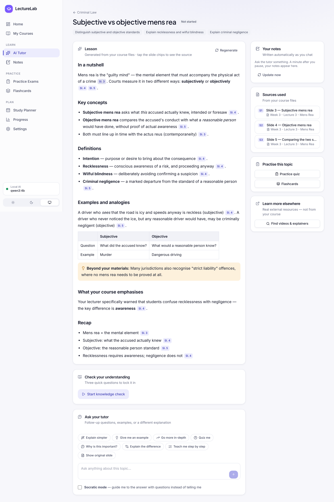 | **AI Tutor:** a lesson built from the slides; chips like "Sl. 4" open the original slide |
| 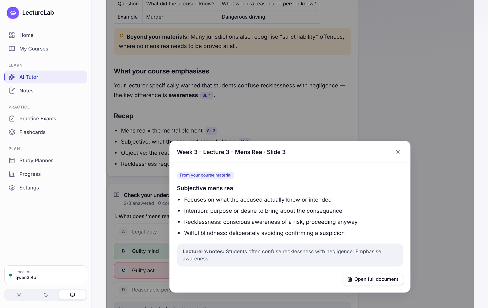 | **Source preview:** the original slide behind any claim |
| 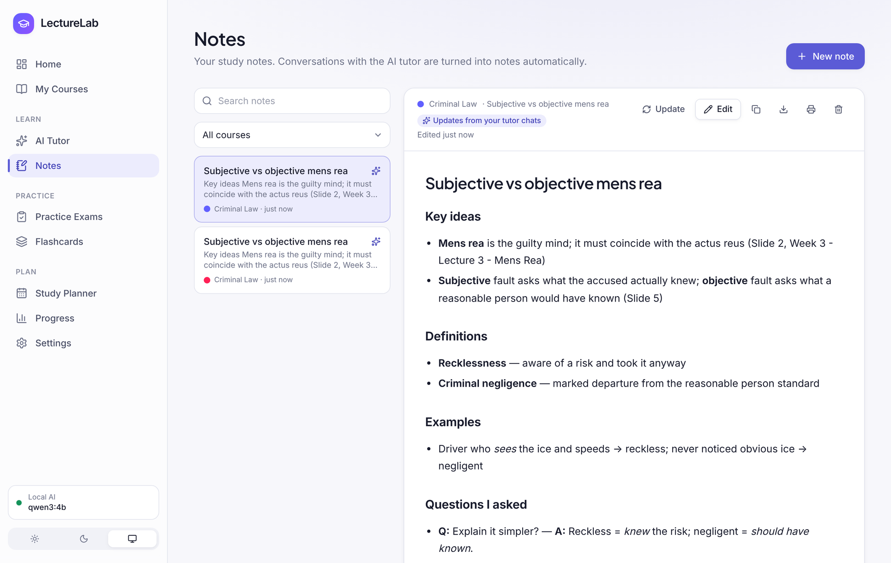 | **Notes:** written automatically from tutor conversations, and editable |
| 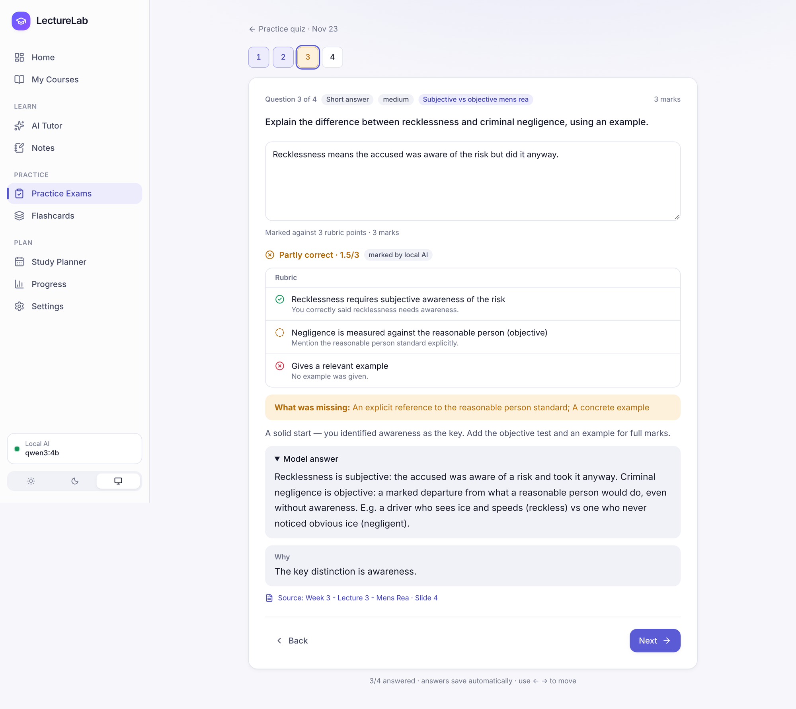 | **Practice exam:** rubric marking of written answers |
| 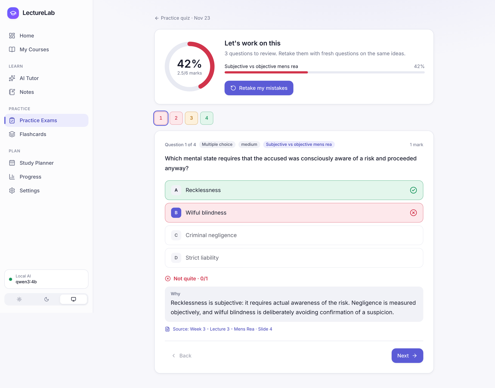 | **Exam results:** score ring, per-topic breakdown, "Retake my mistakes" |
| 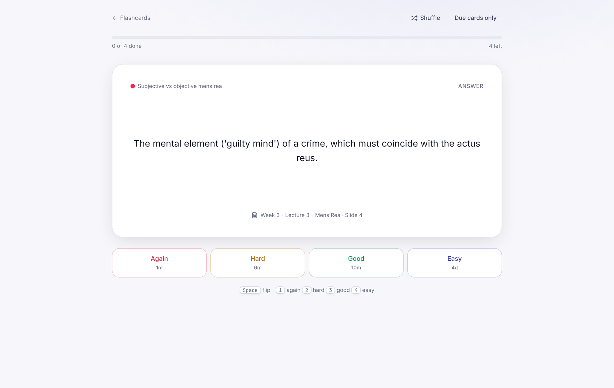 | **Flashcards:** flip cards with Again / Hard / Good / Easy |
| 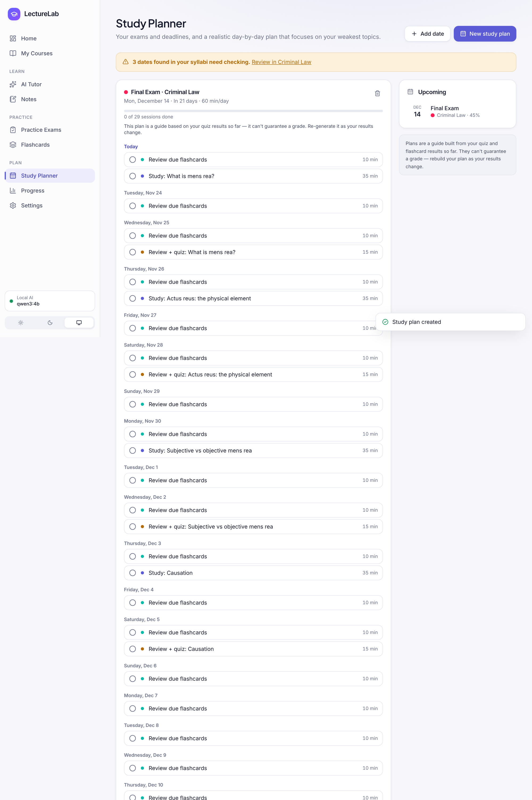 | **Study planner:** day-by-day plan up to the exam |
| 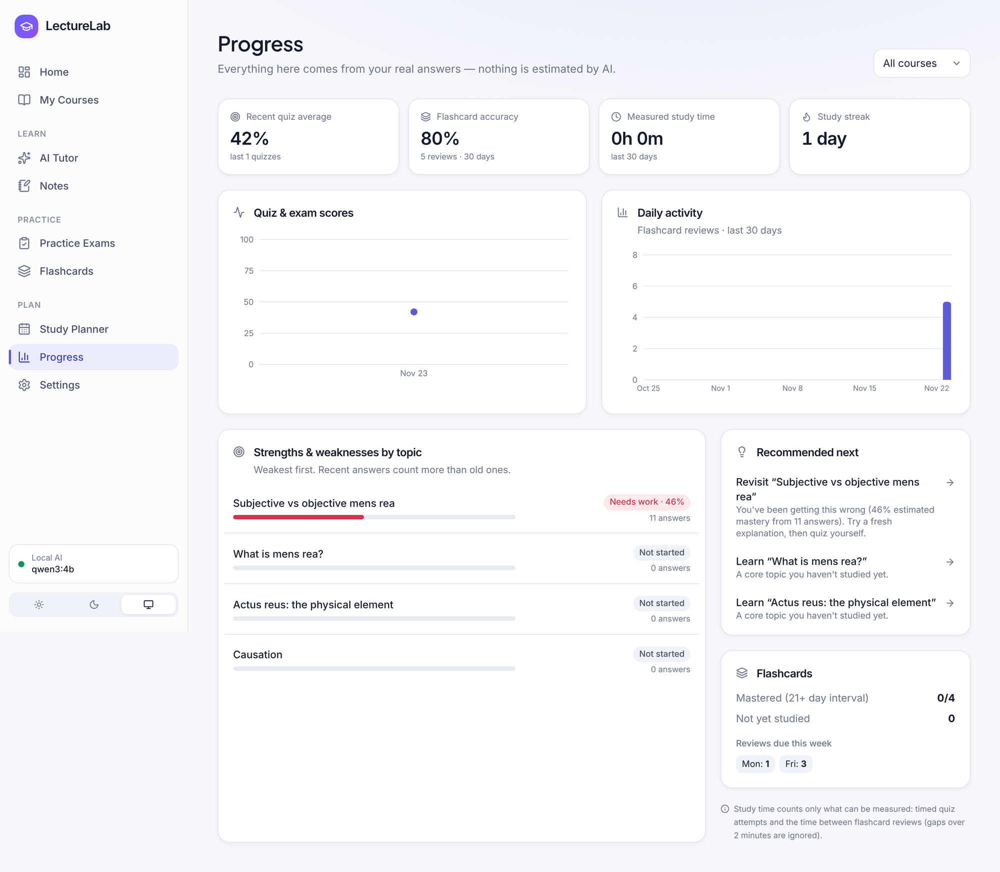 | **Progress:** scores and strengths per topic |
| 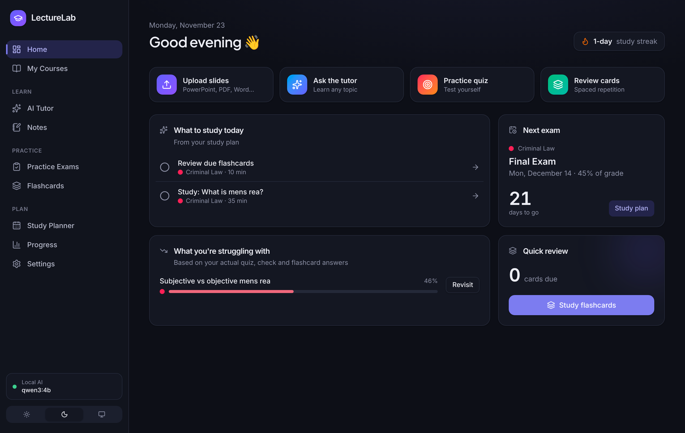 | **Dark mode** |

## What we'd like

1. **Logo and app icon.** A simple, memorable mark that works at 16 px (browser tab) and 1024 px (Mac/Windows icon). Ideas to explore: slide + spark, lab flask + book, cap + chat bubble. Deliver as SVG, plus a 1024×1024 PNG with a transparent background.
2. **Colour palette refresh** (optional). Keep it accessible (WCAG AA contrast) in both light and dark mode. Deliver hex codes for: primary, primary-hover, soft primary background, accent gradient (2 stops), and success/warning/danger.
3. **Polish suggestions for the Home and Tutor screens.** Mockups, or a numbered list of specific changes (spacing, hierarchy, colour, illustration).
4. **Empty-state illustrations** (optional): "no courses yet", "no notes yet", "all caught up on flashcards". A consistent simple style (SVG, 2–3 colours from the palette).
5. **TikTok and social assets:** a 1080×1920 video cover template and a 1200×630 link-preview image.

**Constraints:** must work in light and dark mode; readable on a 13" laptop; no stock photos of people; avoid generic "AI brain" and robot clichés.

**Hand back:** SVG/PNG files and hex codes. Add them to an issue or drop them in a chat, and they'll be built into the app.

---

## Ready-to-paste prompt for ChatGPT

> I'm designing a desktop study app called **LectureLab**. It turns university students' lecture slides into a private AI tutor, practice exams, flashcards and automatic study notes. The AI runs on the student's own laptop (free and private). The audience is 18–24-year-old students who find it on TikTok. The brand should feel calm, smart and encouraging: Notion's clarity + Duolingo's warmth + Linear's polish.
>
> The current design uses indigo `#5B5BD6` with an indigo→violet gradient (`#6366F1` → `#8B5CF6`), Plus Jakarta Sans headings, Inter body text, rounded cards and Lucide line icons. There's a light mode (`#F7F7FB` background) and a dark mode (`#0D0F17`). I've attached screenshots of the main screens.
>
> Please:
> 1. Design 3 logo / app-icon concepts that work at 16 px and 1024 px. Avoid robot or brain clichés. Then refine my favourite into a final SVG.
> 2. Suggest a refined, accessible colour palette (hex codes for primary, hover, soft background, gradient stops, success, warning, danger) for light and dark mode.
> 3. Give me 10 specific, numbered improvements to the Home and AI Tutor screens (layout, hierarchy, spacing, colour), and a mockup of the improved Home screen.
> 4. Create a simple illustration style for empty states, with examples for "no courses yet" and "all caught up".
> 5. Create a 1080×1920 TikTok cover template and a 1200×630 link-preview image.
>
> Keep everything usable in both light and dark mode, and readable on a 13" laptop.
